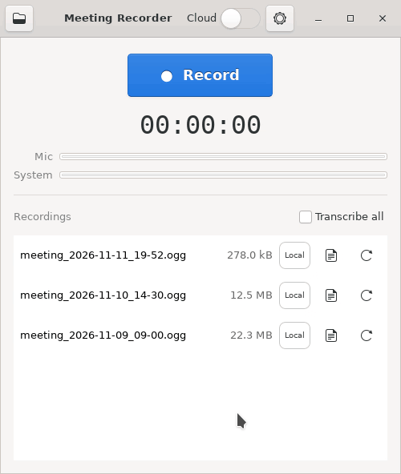

# Meeting Recorder

[](https://github.com/mrmartin/meeting-recorder/actions/workflows/ci.yml)
[](https://github.com/mrmartin/meeting-recorder/releases/latest)
[](https://github.com/mrmartin/meeting-recorder/releases)
[](LICENSE)
[](https://github.com/mrmartin/meeting-recorder/releases/latest)
[](#transcription)

**Record and transcribe your online meetings on Linux. No bot joins the call, and nothing leaves your computer.**

<p align="center">
  
</p>

Meeting Recorder captures both sides of a call, your microphone and the other
participants, into one small audio file. Then it turns the recording into a
transcript that shows who said what:

```markdown
**[00:00:13] Them:** Two things. We need the final screenshots, and someone has to test the sign-up flow on a phone.

**[00:00:19] Me:** I can take the screenshots today. Could you handle the phone test by Wednesday?

**[00:00:23] Them:** Yes, Wednesday works. I will send you the results in the morning.
```

- **Made for Linux.** One download, under 1 MB. Works with Zoom, Teams, Google
  Meet, or anything else that plays sound through your computer.
- **No bot in the call.** It records what your computer hears. Nothing joins
  the meeting and nobody gets an invitation.
- **Private.** Transcription runs on your own computer. No account, and nothing
  is uploaded unless you switch on the optional cloud service yourself.
- **Me and Them, kept apart.** Your voice and theirs are recorded on separate
  channels, so the transcript knows who spoke.
- **Free and open source** (MIT licence).

Please tell people when you are recording. In many places the law requires
everyone's consent.

## Install

1. Download **[MeetingRecorder-x86_64.AppImage](https://github.com/mrmartin/meeting-recorder/releases/latest)** (under 1 MB)
2. Make it executable: right-click the file → **Properties** → enable **Execute as program**
   (or in a terminal: `chmod +x MeetingRecorder-x86_64.AppImage`)
3. Double-click it to start. The app adds itself to your applications menu, so next time just search for "Meeting Recorder".

Made for Linux desktops with PulseAudio or PipeWire, and used daily on Ubuntu. No root, no packages, no account. In the rare case something is missing, the app tells you the exact command to install it.

## How to use

1. **Before your meeting**, open Meeting Recorder and press **● Record**. The level bars confirm both your mic and the meeting audio are being captured, and you can watch the file grow while recording.
2. **After the meeting**, press **■ Stop**. The recording appears in the list (`~/Recordings/meeting_YYYY-MM-DD_HH-MM.ogg`) and plays in any audio player.
3. Press **Transcribe** next to a recording. The first time, the app offers a one-time download of the speech-recognition components (~1.5 GB, all local). When it finishes, a document icon appears — click it to read your transcript.

Have a backlog? Tick **Transcribe all** above the list and the app works
through every untranscribed recording from newest to oldest — including new
ones as you record them (it politely waits while a recording is running).
The selection is remembered across app restarts. A recording it has finished
is never done again, even if you clear the `.transcribe` cache or move, rename
or delete the transcript; to redo one, use the button on its row.

Recordings go to `~/Recordings`, with each transcript beside its recording. To
change either, open the gear button and pick a **Recordings** or **Transcripts**
folder. If a chosen transcripts folder goes missing, such as an unplugged drive,
**Transcribe all** waits until it is back.

Transcription is local by default, so no audio or text leaves your machine.
An optional **Cloud** switch uses a separately configured transcription
service; the app asks for consent before uploading anything.

---

## How it works

**Recording.** A single GStreamer pipeline captures the default output's
**monitor source** (`@DEFAULT_MONITOR@` — what your speakers play) and the
default **microphone** (`@DEFAULT_SOURCE@`), and interleaves them as the two
channels of a stereo Opus stream (left = mic, right = system). Keeping the
sources on separate channels is what makes exact Me/Them transcript
attribution possible; one pipeline clock means the channels can't drift.
On stop, the app sends EOS so the Ogg file is finalized and seekable.

If the host's GStreamer lacks the pulse/opus elements, the app falls back to
two `parecord` processes joined with `ffmpeg` at stop time (level meters are
hidden in that mode).

**Transcription.** The `transcriber/` package runs in a dedicated venv
(`~/.local/share/meeting-recorder/venv`, created on first use, ~1.5 GB with
the model — CPU-only, no CUDA, no torch). Each channel is transcribed
separately with faster-whisper (large-v3-turbo), echo of the speakers picked
up by the mic is removed by text-similarity dedup against the system channel,
and the two sides are merged into timestamped speaker turns with
pause-based sentence restoration. Legacy mono recordings (v1 format) get a
plain timestamped transcript without speaker labels. Everything is cached
under `~/Recordings/.transcribe/`, so re-runs and setting tweaks are fast.

**Optional cloud transcription.** Open transcription settings from the gear
button, enter your own API key, and choose a two-letter language code (`en` by
default). The **Cloud** switch then applies to individual buttons and
**Transcribe all**. Stereo recordings are split locally and the Me/Them
channels are uploaded and transcribed separately before the normal echo
removal and speaker-labelled rendering. Anything over an hour is cut into parts
of up to about an hour, in pauses, and an interrupted upload resumes from the
last finished part. The key is stored in
`~/.config/meeting-recorder/settings.json` with user-only permissions.
Each completed row shows a **Local** or **Cloud** badge for its active
transcript. Recordings that already completed cloud transcription are skipped
by later cloud batch runs and cannot accidentally be submitted twice.

Uploads go over HTTPS. A plain-HTTP endpoint is refused unless the app is
launched with `MEETING_REC_ALLOW_INSECURE_CLOUD=1`, which is for local testing
only.
Cloud-retranscribing an existing local result preserves it as
`meeting_….transcript.local.md` before replacing the normal transcript.

CLI (same engine as the button):

```sh
~/.local/share/meeting-recorder/venv/bin/python -m transcriber \
    ~/Recordings/meeting_X.ogg [--model large-v3-turbo] [--set merge.turn_gap_s=2.5]
```

Useful settings: `--set merge.pause_split_s=0` (disable pause splitting),
`--set merge.turn_gap_s=2.5` (how long a silence starts a new turn).

## Development

```sh
./run.sh                                  # run from source
python3 tests/test_transcriber.py         # transcription unit tests
python3 tests/test_cloud.py               # cloud tests (localhost only)
/usr/bin/python3 -m meeting_recorder.recorder   # 5s headless recording smoke test
packaging/build-appimage.sh               # build the AppImage
```

`run.sh` picks the first `python3` that has PyGObject (skipping conda/pyenv
environments that lack it). CI runs the same tests and builds the AppImage
on every push.

```
meeting_recorder/
├── main.py                     # entry point: backend selection, launch UI
├── meeting_recorder/           # GTK app: window, recorder pipelines, launcher
├── transcriber/                # ASR, diarization, echo dedup, rendering
├── tests/                      # logic tests (no audio hardware needed)
└── packaging/                  # AppRun, .desktop, icon, build script
```

## Tips

- Recordings capture **whatever your system plays** — mute notifications
  during meetings.
- The transcript is plain Markdown next to the audio file — edit, grep, or
  paste it anywhere.
- Old recordings from v1 (mixed mono) transcribe without speaker labels;
  stereo recordings (v2+) get exact Me/Them attribution.
